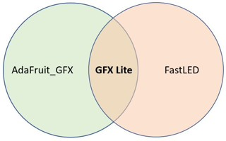

# GFX_Lite

GFX_Lite combines Adafruit_GFX-style software drawing primitives with FastLED's `CRGB`, HSV, palette, blending, and color utility APIs. The library contains no display transport or physical LED-output driver. A target integrates it by deriving from `GFX` and implementing the two `drawPixel` overloads, or by using the optional callback-backed `GFX_Layer` framebuffer.



## What is included

- Lines, rectangles, circles, triangles, rounded rectangles, bitmaps, and text rendering.
- RGB565 compatibility for existing GFX-style callers and native 24-bit `CRGB` drawing/text colors.
- FastLED-derived color types, HSV conversion, palettes, color utilities, and software noise/math routines.
- Optional off-screen `GFX_Layer` buffers and a compositor.

The core still uses Arduino's `Print` API and Arduino font-storage conventions. It is intended for Arduino-compatible targets, not a standalone desktop C++ build without compatibility shims.

## Minimal framebuffer example

See [`examples/framebuffer/framebuffer.ino`](examples/framebuffer/framebuffer.ino) for a complete generic example. A target-specific display adapter can replace the framebuffer writes in its `drawPixel` implementations.

```cpp
#include <GFX_Lite.h>

class Canvas : public GFX {
public:
  Canvas() : GFX(64, 32) {}

  void drawPixel(int16_t x, int16_t y, uint16_t color) override {
    drawPixel(x, y, color565_to_CRGB(color));
  }

  void drawPixel(int16_t x, int16_t y, CRGB color) override {
    if (x >= 0 && x < width() && y >= 0 && y < height()) {
      pixels[y][x] = color;
    }
  }

  CRGB pixels[32][64];
};

Canvas canvas;
CRGBPalette16 palette = RainbowColors_p;

void setup() {
  canvas.setTextColor(CRGB::White);
  canvas.setCursor(0, 10);
  canvas.print("GFX_Lite");
  canvas.drawPixel(20, 20, ColorFromPalette(palette, 96));
}

void loop() {}
```

## Examples

- [`examples/framebuffer/framebuffer.ino`](examples/framebuffer/framebuffer.ino) — generic in-memory target; no display hardware dependency.
- [`examples/basic/basic.ino`](examples/basic/basic.ino) — optional ESP32 HUB75 integration using ESP32-HUB75-MatrixPanel-I2S-DMA.
- [`examples/advanced/advanced.ino`](examples/advanced/advanced.ino) — optional HUB75/layer/compositor integration. The display library and its hardware setup are example-only dependencies.

## Optional layers

Include `GFX_Layer.hpp` to use a CRGB framebuffer. Each layer stores one contiguous RGB array and one 8-bit opacity value for the whole layer. Layers are fully opaque by default; use `setAlpha()` to change a layer's opacity, or `setColorKey()` for hard per-pixel transparency based on a matching color. A color key makes every matching color transparent, so choose a key color that is not needed as a visible pixel.

Composition writes the foreground over the background into a destination layer. It uses ordinary alpha blending: `setAlpha(0)` leaves the background unchanged, and `setAlpha(255)` replaces it with the foreground wherever it is not transparent. Present pixels only when needed by passing a sink to `present()`; the sink receives x, y, and RGB color:

```cpp
GFX_Layer background(64, 32), foreground(64, 32), result(64, 32);
GFX_LayerCompositor compositor;

foreground.setColorKey(CRGB::Black);
foreground.clear(CRGB::Black); // black pixels are transparent during composition
foreground.setAlpha(192);      // 0 = transparent, 255 = opaque
foreground.setPixel(4, 4, CRGB::White);
compositor.composite(background, foreground, result);
result.present([](int16_t x, int16_t y, CRGB color) {
  // Send color to the application's chosen display or output.
});
```

### Allocating layer buffers in PSRAM (ESP32)

By default `GFX_Layer` allocates its pixel buffer from internal SRAM. On ESP32 targets you can move those buffers into PSRAM with the compile-time option `GFX_LAYER_PSRAM`:

```ini
; platformio.ini
build_flags = -DGFX_LAYER_PSRAM=1
```

When enabled, the layer buffer (and the temporary scratch buffer used by `blur()`) is allocated with `heap_caps_malloc(..., MALLOC_CAP_SPIRAM | MALLOC_CAP_8BIT)`. If PSRAM is unavailable or exhausted, allocation falls back to internal RAM automatically. The option is ignored on non-ESP32 targets, which always use SRAM.

`GFX_LITE_MAX_LAYER_MEMORY` still caps the maximum layer size (1 MiB by default), so raise it as well if you want larger PSRAM-backed layers:

```ini
build_flags = -DGFX_LAYER_PSRAM=1 -DGFX_LITE_MAX_LAYER_MEMORY=4194304UL
```

## Installation and compatibility

Install this repository in an Arduino libraries directory (i.e. download a zip of this repo) and include `GFX_Lite.h`.
